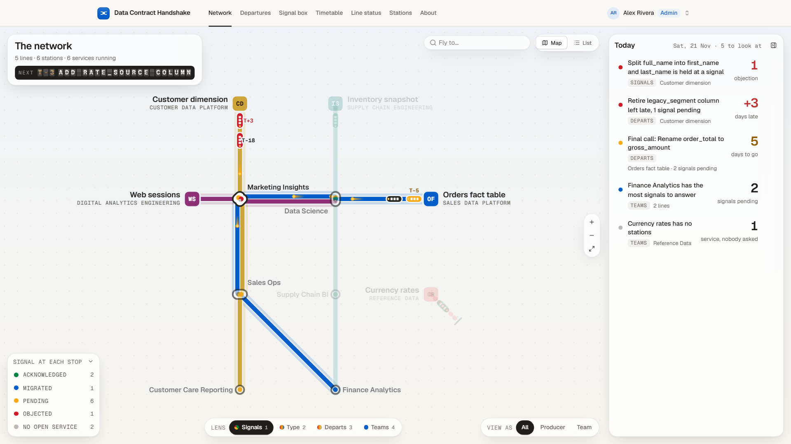

# Data Contract Handshake

Producers announce a change to a table or dataset, every registered consumer team must acknowledge it, and anything
unacknowledged near its effective date turns red. It replaces "did anyone read the email?" with a visible handshake,
drawn as a transit network: a registry of data contracts (lines), change notices with an ack matrix per consumer team
(trains and signals), a signal box for the teams you belong to, and a departures board of what is at risk, overdue or
blocked. A Fabric App (Rayfin 2.0) on a Fabric SQL database.



## What it looks like

**The transit network.** Every contract is a line on a metro map that starts at its producer's terminal; every consumer
team is a station, and a team that consumes several contracts is an interchange. Each published change notice is a
train waiting at the terminal with a departure countdown (its effective date), and a pending ack is a signal still
travelling down the line to the station that has to answer.

- **Lenses** (keys 1–4): *Signals* (each stop's answer: acknowledged, migrated, pending, objected), *Type* (breaking,
  deprecation, additive), *Departs* (days to departure) and *Teams* (signals each station still has to answer).
- **View as** (V): everyone, a producer (your own lines, or one producer team) or one consumer team; the rest of the map
  dims. **Today** ranks the three to five things that need attention (held, late, final call, the busiest station, a line
  with no stations); each one flies the map to the train or station behind it. Drag to pan, wheel or `+ − 0` to zoom,
  `/` to fly to anything, `?` for the shortcuts.
- **Tools:** *Departures* (a split-flap board with a signal lamp per team, filters and a wall-screen mode, key W),
  *Signal box* (your teams' pending signals with the acknowledge, object and migrated levers), *Timetable* (every
  line's services on a calendar with the final-call window, and *Announce a change* with a live board preview),
  *Line status* (the registry, worst status first) and *Stations* (teams and their members).
- **Fallbacks:** the map is SVG, so it needs no WebGL (`?nowebgl` renders the same map); *List* (key L) shows the same
  services and lines as tables; reduced motion stops the travelling signals, blinking lamps, flap riffles and camera
  flights; phones get a portrait layout, a bottom sheet for Today and an agenda instead of the timetable chart.

Screenshots of every screen (1280 and 390 px, light and dark, lenses and a focused Today item): [docs/redesign](docs/redesign).

Demo video (about 2 minutes, AI-generated narration, captions burned in): [demo/out/data-contract-handshake.mp4](demo/out/data-contract-handshake.mp4) · captions file [demo/out/data-contract-handshake.srt](demo/out/data-contract-handshake.srt). Re-record with `npx tsx tools/demo/record.ts data-contract-handshake` from the repo root.

## 1. Prerequisites

- Microsoft Fabric with the **Fabric Apps** workload enabled for your tenant.
- A workspace on a Fabric capacity (F2 or larger, or a trial), and **Contributor/Edit** permission on it.
- Node.js 20 or later (the monorepo is tested on Node 24).
- No connectors, semantic models or extra tenant settings are needed. Anonymous data access is **not** used.

## 2. Run locally

```bash
# at the repository root, once
npm install

# in apps/data-contract-handshake
npm run dev          # offline demo on http://localhost:5203: in-memory data, seeded, persona switcher
npm run dev:fabric   # rayfin dev: the real Rayfin backend with your Fabric sign-in
```

Demo mode keeps data in your browser (localStorage). Use the identity menu (top right) to view as a persona, or open
`/?as=<sub>`. "Reset demo data" re-seeds.

| Persona | Sub | Shows |
|---|---|---|
| Alex Rivera (admin) | `demo-admin` | Admin overrides (close a notice early with a note, change any ack), team management. Owns *Currency rates*. |
| Morgan Lee (producer) | `demo-producer` | Owns four contracts: add/remove consumers, draft, publish and close notices. |
| Priya Shah | `demo-finance` | Finance Analytics consumer. |
| Jordan Kim | `demo-two-teams` | One person in two teams: Finance Analytics and Sales Ops. |
| Chen Wu | `demo-marketing` | Marketing Insights consumer. |

Checks (all run in this folder):

```bash
npx tsc -b
npx vitest run
npx vite build --mode demo
npx playwright test     # phone (390px) and desktop (1280px) projects
```

## 3. Deploy

```bash
npx rayfin login
npx rayfin up --workspace-id <workspace-id>
npx rayfin up status
```

`rayfin up` builds the app (`npm run build:fabric`), creates the app backend, SQL database and hosting, applies the
schema (including later schema changes), and uploads `dist/`. Users need access to the app item (workspace members get it
by default) and sign in with Fabric SSO.

## 4. Seed

```bash
# from the repository root
node tools/seed-fabric.mjs --app data-contract-handshake --admin-email you@org.com
# or, from this folder
npm run seed:fabric -- --admin-email you@org.com
```

Open the deployed app once first so your Person row exists. The script loads the demo rows into the app's SQL database
(skipped when the `seed:v1` marker exists; the marker is written last) and makes you an admin. With `--admin-email`, the
first persona (Alex Rivera, the admin) is mapped to you: you own the *Currency rates* contract and are recorded as the
admin who added the seeded team memberships, so the row policies let you edit those rows. It inserts the five
persona Person rows, 5 contracts, 12 consumers, 4 team memberships, 9 notices and 22 acks, with every date computed from
the day you run it:

- at risk (breaking, 5 days out, two teams pending), waiting (additive, exactly 7 days out), blocked (an objection),
  overdue (a deprecation 3 days past), ok (everyone answered, including a consumer removed after publish), ok with a
  warning (a contract with no consumers), a closed notice, a draft ready to publish, and a draft whose date has passed.

To make someone an admin by hand, run this in the Fabric SQL editor (tables are pluralised):

```sql
UPDATE dbo.People SET isAdmin = 1 WHERE email = 'you@yourorg.com';
```

The other personas keep fictional `demo-…` subjects, so in a real tenant Morgan's four contracts and the consumer teams'
acks belong to people nobody can sign in as. Register your own contracts to try the producer flow, add real colleagues to
teams on the Stations page, or delete the sample rows.

## 5. How it works

### Entities (`rayfin/data/`, mirrored in `src/model.ts`)

| Entity | Fields | Notes |
|---|---|---|
| `Contract` | name (3–100), sourceRef (3–200), producerTeam (2–100), ownerSub, ownerName, description (≤500, optional), createdAt | The creator is the owner. sourceRef is unique (checked in the app). |
| `Consumer` | contractId, teamName (2–100), contactName (2–100), contactSub (optional), ownerSub, createdAt | ownerSub is the contract owner, copied for the row policy. |
| `ChangeNotice` | contractId, title (3–120), changeType (`additive`/`breaking`/`deprecation`), description (10–2000), effectiveDate, status (`draft`/`published`/`closed`), ownerSub, createdBy, createdByName, createdAt, publishedAt, closedAt, closedByName, closeNote (≤300) | effectiveDate is a calendar day stored as UTC midnight, so it never shifts with time zones. |
| `Ack` | noticeId, consumerId, contractId, teamName, contractOwnerSub, status (`pending`/`acknowledged`/`objected`/`migrated`), note (≤300), updatedBy, updatedByName, updatedAt | teamName is copied so the matrix still reads well after a consumer is removed. |
| `TeamMember` | teamName (2–100), memberSub, memberName, addedBySub, createdAt | Maps a person to a consumer team. |
| `Person`, `AppMarker` | shared | Identity (isAdmin set by SQL) and the seed marker. |

### Team membership

The spec's `Consumer` has one `contactSub`, but a team has several people and one person can be in several teams. The
app adds a `TeamMember` row per (team, person), and keeps two kinds of rights apart:

- **Team membership is global and admin-only.** A `TeamMember` row links a person to a team name; team names compare
  case- and space-insensitively, so "Sales Ops" on two contracts is one team. A member answers for that team on every
  contract it consumes. Only admins add members (Stations page); a member can leave.
- **A consumer contact is scoped to one registration.** The contact person a contract owner links to a consumer
  (`contactSub`) may answer that consumer's acks only. It never makes them a member of the team. This matters because
  anyone can register a contract: someone who adds "Finance Analytics" to their own contract with themselves as contact
  gains nothing on other producers' Finance Analytics acks (covered by the "privilege escalation" unit tests).
- **The signal box** (`/inbox`) lists pending acks on published notices that the viewer answers for (their teams, plus consumers they are
  the contact of), soonest effective date first.
- **Who may set an ack**: a member of the ack's team, the contact of that consumer, the contract owner, or an admin.
  Resetting an ack to pending is for the owner or an admin.

### Rules (`src/domain/`, thresholds in `src/config.ts`)

1. **Publish** (`publishNotice`): for each consumer of the contract, check for an ack with the same (noticeId,
   consumerId) right before inserting a pending one, then set the notice to published last. Running it twice, or after a
   partial failure, only fills in the gaps. A draft whose effective date is before today cannot be published.
2. **Ack**: acknowledged, objected (a note is required) or migrated, only while the notice is published.
3. **Adding a consumer** creates a pending ack for every published notice of the contract. **Removing a consumer** marks
   their open acks (pending or objected, on published notices) migrated with the note "consumer removed".
4. **Health** (`noticeHealth(notice, acks, today)`, pure): blocked if any ack is objected; ok if every ack is
   acknowledged or migrated (or there are no acks: ok with a warning); overdue if the effective date has passed (from the
   day after) with an ack pending; at risk if a breaking change is 7 days or fewer away (today included) with an ack
   pending; otherwise waiting. Additive changes are never at risk. Drafts report waiting.
5. **Close**: when health is ok (owner or admin), or by an admin at any time with a note.

At risk follows spec rule 4 literally: breaking changes only. To treat deprecations the same way (the deprecated thing
disappears on the effective date), set `rules.atRiskTypes` in `src/config.ts` to `['breaking', 'deprecation']`; the
About page, departures board, timetable and editor hints follow the setting.

### Security model

Every entity grants `authenticated` read to everyone signed in. Writes:

| Entity | Row policy (database) | Field limits |
|---|---|---|
| `Contract` | create, update, delete: `claims.sub == ownerSub` | update excludes ownerSub, createdAt |
| `Consumer` | create, update, delete: `claims.sub == ownerSub` (contract owner, denormalised) | update excludes ownerSub, contractId, createdAt |
| `ChangeNotice` | create, update, delete: `claims.sub == ownerSub` (contract owner, denormalised) | update excludes ownerSub, contractId, createdBy, createdAt |
| `Ack` | create, delete: `claims.sub == contractOwnerSub`; update: no row predicate | update may change only status, note, updatedBy, updatedByName, updatedAt |
| `TeamMember` | create: `claims.sub == addedBySub`; delete: `claims.sub == addedBySub or claims.sub == memberSub`; no update | – |
| `Person` | create/update own row only | isAdmin never writable from the client; sub fixed |
| `AppMarker` | read only | – |

Enforced in the domain functions (both demo and Fabric), because the policy DSL cannot join tables and there is no admin
claim: that a consumer or notice's contract is really owned by the caller (the denormalised ownerSub is copied from the
contract by the app), ack team membership and contact scope, admin overrides, "only drafts can be edited or deleted", the
past-date publish block, the objection note, and "only admins manage teams".

## 6. VERIFY outcomes and known limits

VERIFY outcomes (shared, see `shared/NOTES.md`): `@int`/`@set` exist and are used for enums; no realtime, so the network map,
signal box, notice, timetable and departures board poll every 5 s; the map and board are hand-built SVG and CSS (no chart library); only the `authenticated` role is used; tables are pluralised
(`dbo.ChangeNotices`, `dbo.Acks`, `dbo.TeamMembers`).

Deployed to a Fabric workspace on 20 Nov 2026: `rayfin up` applied the schema and every row policy and field
restriction in the table above was accepted.

Known limits:

- **Ack updates are not row-restricted in the database.** Any signed-in user could change an ack's status fields
  through the GraphQL API directly, bypassing the team check (they cannot re-point an ack to another notice, team or
  owner). The app UI and domain functions enforce the rule. Closing this needs team membership in the token (dynamic
  auth claims), listed under Later.
- **Admin overrides are app-level only.** The database lets only the contract owner update a notice, so in Fabric an
  admin who does not own the contract cannot close its notice early: the write is refused with a permission error. In
  demo mode the override works. An admin who must force-close can ask the owner, or update the row with SQL.
- **TeamMember writes are not admin-only in the database.** There is no admin claim, so the create policy only pins
  `addedBySub` to the caller; a signed-in user could add themselves to a team by calling the API directly. The app UI
  never offers this (only admins see the form, and `addTeamMember` refuses non-admins), and since ack updates are already
  app-enforced it does not widen access beyond the limit above. An admin can remove only memberships they added, or a
  member can remove themselves (the delete policy).
- **Cross-row ownership is not checked by the database.** A user could insert a Consumer or ChangeNotice with their own
  sub as ownerSub against someone else's contractId through the API. The app never does this and every screen reads the
  owner from the contract.
- **The Fabric build embeds the Rayfin API URL and publishable key in the JavaScript bundle.** The URL contains the
  tenant and workspace ids. Neither is a secret (the publishable key is meant for clients, and every request still needs
  a Fabric sign-in), but they are visible to anyone who can load the app. Nothing of the kind is committed: `rayfin up`
  writes them to an ignored env file at build time.
- Publishing is not a transaction (Rayfin has none). It is idempotent instead: a retry finishes the job.
- Effective dates are calendar days; "today" is the viewer's local date.

## 7. Later

- CSV export of the ack matrix.
- A Function that emails consumer contacts 7 days before the effective date.
- Dynamic auth claims (`udf.authClaims`) carrying team names and an admin flag, so ack updates, team management and
  admin overrides are enforced by row policies too.
- Rescheduling a published notice (today: close it and announce a new one).
- Transferring contract ownership.

## 8. Gallery

**Title:** 12 Days of Fabric Apps: Day [#] – [Theme]: Data Contract Handshake

**Blurb (≤80 words):** Schema changes shouldn't be a surprise. Data Contract Handshake draws your data contracts as a
transit network: each contract is a line, each consumer team a station, each announced change a train that departs on
its effective date. Every station must acknowledge, object or confirm migration; a split-flap departures board shows
what is on time, on final call, delayed or held. Teams answer from their signal box. Built on Fabric Apps with a Fabric
SQL database and Fabric sign-in.

**Tags:** Partner | 12 Days of Fabric Apps · Fabric Apps · Data contracts · Data governance · Fabric SQL database
